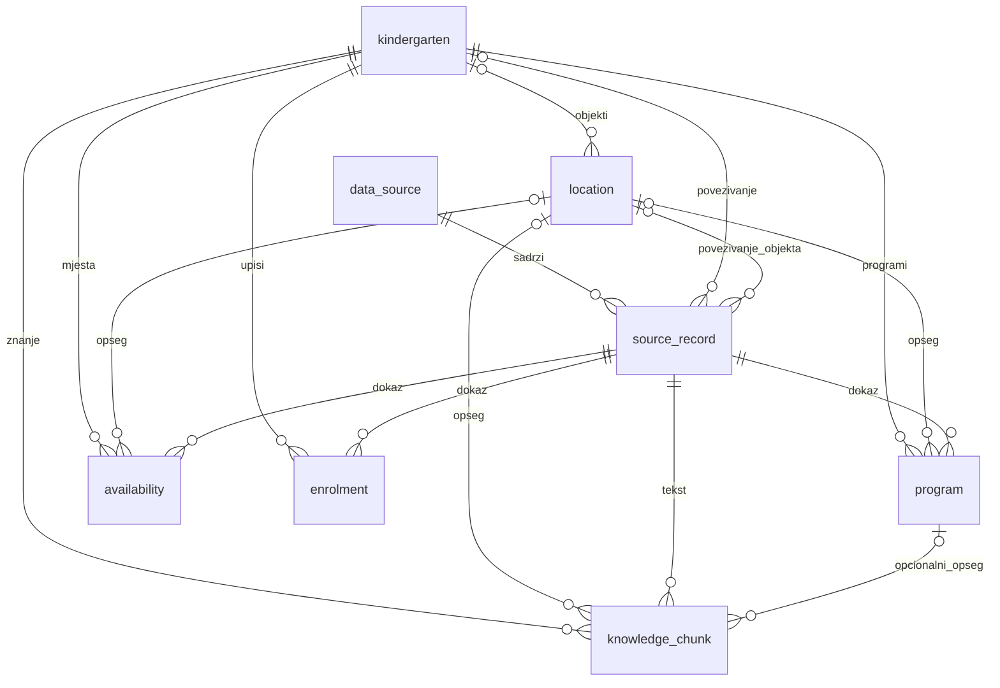

# Jednostavni ERA model s RAG podrškom

Model ima **8 tablica**, umjesto prethodne 23. PostgreSQL, asyncpg i Alembic ostaju. PostGIS služi prostornim upitima, a pgvector RAG pretrazi u istoj bazi.

Osnova: [TO-DO](../TO-DO.md) i [istraživanje izvora](../docs/istrazivanje-vrtici-otvoreni-podaci.md). [Potpuni dijagram](era.svg), [rječnik stupaca](rjecnik-podataka.md) i [pokretanje](README.md).

## Entiteti i veze



| Tablica | Što čuva |
|---|---|
| `data_source` | Jedan logički skup, izdavača, URL, licencu, dopuštenje uvoza, aktivnu snimku, datume i prag zastarjelosti. Kataloške preslike i različiti formati u `metadata`. |
| `source_record` | Izvorni JSON retka, izvorni ključ, UUID serije uvoza, datume, povezani vrtić/objekt i odluku `candidate/accepted/rejected`. |
| `kindergarten` | Ustanovu/pružatelja, vrstu, kontakte i podrijetlo kanonskih atributa. |
| `location` | Matični/područni/nepoznati objekt, adresu, grad, županiju, četvrt i provjerene koordinate. Jezici objekta, kuhinja, dvorana i dodatni kontakti u `attributes`. Nepovezan objekt može imati NULL ustanovu. |
| `program` | Potvrđeni program ustanove ili jednog objekta, dob u mjesecima, jezike, datum provjere i rok valjanosti. |
| `availability` | Objavljena mjesta s datumom, izvornom dobnom/programskom oznakom i opsegom ustanove ili objekta. NULL nije nula. |
| `enrolment` | Pedagošku godinu, službeni kanal/URL, rokove i poredane korake/dokumente kao JSON liste. |
| `knowledge_chunk` | Izvorni tekstualni odlomak, izvorni redak, URL, hash sadržaja, opseg, embedding i oznaku modela. |

Svi PK-ovi su UUID; veze su FK-ovi, a složeni FK-ovi osiguravaju da objekt pripada istoj ustanovi. Rječnik navodi točne tipove, obveznost, ključeve i indekse. Grad je sada izravno na objektu: nema nadtipa `entity`, posebnog šifrarnika područja ni zasebnih tablica jezika. Koraci i dokumenti čitaju se zajedno s upisnim pozivom pa su JSON liste dovoljne za MVP.

## Kako radi korisnikov primjer

Upit: **„Imam dijete od 2 godine i iz varazdina sam koji su mi vrtici opcija?”**

1. `parse_request` izdvaja `age_months=24` i `city=varazdin`. Dijakritici se normaliziraju; oblik `varazdina` postoji u kontroliranom `city_aliases` popisu lokacije. Popis mora popuniti uvoznik, a ne nagađati LLM.
2. `find_options` filtrira grad i provjerava postoji li potvrđeni program za dob `min_age_months <= 24 < max_age_months_exclusive`. Provjerava prihvaćeno povezivanje, dopušteni izvor, njegov aktivni batch, datum provjere, valjanost i konfiguriranu svježinu.
3. Rezultati s dokazom idu u `confirmed`. Oni bez poznatih dobnih uvjeta idu u zasebni `age_unknown`. Poznat program koji isključuje dob nije potvrđena opcija. Ako postoje poznati neodgovarajući i dodatni nepoznati programi, konzervativna MVP pretraga taj objekt izostavlja; ne pretpostavlja prikladnost.
4. `retrieve_context` dohvaća RAG odlomke **samo za potvrđene rezultate**, iz aktivnih dopuštenih izvora i prihvaćenih povezivanja. Programski odlomci dodatno su ograničeni na potvrđene dobno prikladne `program_id` vrijednosti; program neodgovarajuće dobi na istom objektu ne ulazi u kontekst. Ustanovini odlomci mogu vrijediti za sve njezine objekte; odlomci konkretnog objekta ostaju unutar tog objekta.
5. `recommend` vraća kriterije, potvrđene rezultate s `age_evidence` (program, dokazni redak, URL, datum i opseg), nepoznate rezultate i kontekst s URL-ovima. Budući MCP/LLM sloj od toga oblikuje odgovor. Odgovor ne smije proširiti listu kandidata na osnovi teksta.

Dobna prikladnost nije potvrda slobodnog mjesta ili upisa. Program bez `location_id` potvrđen je na razini ustanove; za odabrani objekt treba provjeriti gdje se izvodi. Sučelje mora označiti taj opseg. `recommend` trenutno vraća podatke za odgovor, bez generiranja slobodnog teksta.

**Granica podataka:** istraženi nacionalni MZOM JSON nema dobne uvjete. Ne postoji dokaz da svaki varaždinski vrtić prima dvogodišnjake. Sam imenik zato može dati lokalne rezultate s oznakom nepoznate dobi; potvrđene odgovore omogućuje tek povezani službeni izvor programa. Testovi koriste jasno označene sintetičke ustanove, ne izmišljene tvrdnje o stvarnim vrtićima.

## RAG u istoj bazi

`knowledge_chunk.embedding` je `vector(384)`. `embedding_model` mora biti jednaka puna oznaka modela/verzije i za dokument i za upit. Dimenzija 384 je početna projektna postavka, a ne odabir konkretnog pružatelja. Druga dimenzija zahtijeva novu Alembic migraciju i ponovno indeksiranje svih odlomaka.

Vektorsko dohvaćanje koristi kosinusnu udaljenost `<=>`, nakon filtriranja kandidata i izvora. Za mali skup radimo točnu pretragu, bez ANN indeksa koji bi nakon dodatnih filtara mogao vratiti premalo rezultata. `search_text` i GIN indeks daju rezervno leksičko dohvaćanje preko PostgreSQL konfiguracije `simple`; to nije puna hrvatska morfologija. Bez embeddinga semantička pretraga se ne glumi: koristi se leksička grana.

Ingestijski slijed: preuzeti dopušteni javni sadržaj → očistiti tekst → razdijeliti u odlomke → izračunati SHA-256 → generirati embedding odabranim višejezičnim modelom → zapisati odlomak, URL, source_record i model. Kad se sadržaj ili model promijeni, treba ponovno generirati embedding. Vektori različitih modela ne uspoređuju se. Generiranje embeddinga i pozivi LLM-u još nisu spojeni s pružateljem; baza i dohvat jesu implementirani i testirani.

Sadržaj izvora tretira se kao podatak: njegove eventualne upute ne izvršavaju se. MCP sloj mora vezati citate uz vraćene `source_url` vrijednosti i jasno navesti nedostatak dokaza. Nema tablica djece, OIB-a djeteta ni trajnog spremanja razgovora.

Reference: [pgvector — tip vector, kosinusna udaljenost i filtri](https://github.com/pgvector/pgvector), [PostgreSQL tekstualna pretraga](https://www.postgresql.org/docs/current/textsearch-controls.html).

## Povezivanje više otvorenih skupova

Jedan `data_source.dataset_key` predstavlja jedan logički skup; RH, gradska i EU preslika istog skupa nisu tri izvora. Njihovi URL-ovi/licence mogu ostati u `metadata.catalogues` i `metadata.resources`.

MZOM izvorni zapis može potvrditi ustanovu; gradski zapis njezin objekt, grad i koordinate; drugi dopušteni izvor može dodati dobni program ili atribute objekta. Svi prihvaćeni retci vode na **isti kindergarten_id/location_id**. Usporedba i pretraga čitaju objedinjeni profil. `provenance` mapira naziv polja na izvorne UUID-ove i zadržava alternativne vrijednosti, primjerice:

```json
{"name": {"selected_record_id": "UUID-MZOM-retka", "alternatives": []},
 "has_hall": {"selected_record_id": "UUID-gradskog-retka", "alternatives": []}}
```

To su ilustrativne oznake, ne stvarni UUID-ovi. Servis mora provjeriti da reference postoje i imaju prihvaćeno povezivanje; JSON ih sam ne provjerava. Programi, mjesta, upisi i RAG odlomci imaju pravi `source_record_id` FK. Izvorni ključevi nisu globalni identifikatori vrtića. Kandidati se ne koriste za dokazivanje prikladnosti. Nepoznato `vdi` ne postaje atribut pristupačnosti, a koordinate bez potvrđenog CRS-a ostaju u sirovom retku.

## Jednostavniji uvoz i ponovljiva demonstracija

Svaki pokušaj uvoza dobiva `batch_id`. Servis zaključava `data_source` redak i u jednoj transakciji učitava retke, provjerava povezivanja/projekcije te tek na kraju promijeni `active_batch_id`, datume i metapodatke. Neuspjeh ostavlja prethodni batch aktivnim. Baza ima tipove i FK-ove; ovaj transakcijski protokol, nepromjenjivost sirovih objavljenih redaka i provjera kvalitete odgovornost su uvoznika koji tek treba implementirati. Novi prazni ili oštećeni skup ne smije automatski zamijeniti valjanu snimku.

Za čitanje programa, mjesta, upisa i RAG-a uvijek filtrirati `source_record.batch_id=data_source.active_batch_id`, `match_status='accepted'` i `import_allowed=true`. Već napisani upiti provode to za programe/RAG. Budući API za mjesta/upise mora primijeniti isto. Datum kataloga, resursa, dohvata i stvarnog stanja ostaju zasebno zapisani u metapodacima i datumskim stupcima.

Za demonstraciju pohraniti SQL dump cijele povezane baze s vektorima i kanonskim profilima, verziju koda, embedding model i manifest hashova izvora; zatim demonstrirati na toj nepromjenjivoj kopiji bez osvježavanja. Sam `active_batch_id` ne zamrzava kanonske profile. Time se zamjenjuju tri posebne tablice izdanja. Izvoz/uvoz demonstracijske kopije ostaje operativni korak.

## Što se još implementira

Uvoznici stvarnih skupova, normalizacija i pregled povezivanja, embedding pružatelj, MCP alati i UI. Dobni i gradski filtri te tekstualno/vektorsko dohvaćanje implementirani su u `src/KIDSic/services/concrete/kindergarten_search.py` i `src/KIDSic/dao/concrete/asyncpg_kindergarten.py`. Mali parser prepoznaje primjer s brojčanom dobi nakon „od/ima”; ne tvrdi da razumije sve prirodne upite. Nedostajuća ili dvosmislena dob/grad vraća `ValueError` za pojašnjenje. Budući MCP alat može poslati validirane strukturirane filtre izravno u `find_options`.
